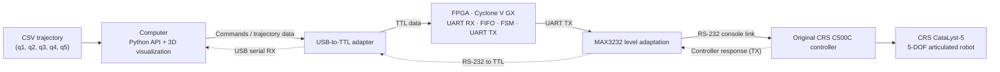

# CRS CataLyst-5 FPGA Trajectory Execution Platform

**A computer-based platform for loading, visualizing and executing joint-space trajectories on a five-degree-of-freedom CRS CataLyst-5 manipulator.**

[]()
[]()
[]()
[]()
[]()

> This repository documents a research platform developed as part of a Master's thesis at the Instituto Nacional de Astrofísica, Óptica y Electrónica (INAOE). Original source code, FPGA project files and experimental media will be added after they have been reviewed and prepared for publication.

## Overview

The platform integrates a Python application, an FPGA-based communication interface and the original CRS C500C robot controller.

1. **Python application:** loads a CSV file containing an ordered sequence of five joint variables, visualizes the manipulator in 3D using forward kinematics, and coordinates the sequential execution of the trajectory.
2. **FPGA communication interface:** implemented in Verilog on an Intel Cyclone V GX. Its UART receiver accepts data from the computer through a USB-to-TTL adapter; a FIFO temporarily stores the data; and a finite-state machine coordinates transmission through the FPGA UART transmitter.
3. **Electrical interface and robot controller:** a MAX3232-based level adapter connects the FPGA transmit channel to the console interface of the original CRS C500C controller. The controller retains its internal robot motion-control functions.

The controller's responses return to the computer through the MAX3232 and the USB-to-TTL adapter. **This return path bypasses the FPGA.** The Python application uses the responses to coordinate the sequential transmission of trajectory points and the corresponding 3D/physical execution.

The platform manages the execution of externally generated joint sequences. It does **not** implement a new motion-control law or an autonomous trajectory planner.

## System architecture

The command and response paths are intentionally shown separately:



- **Forward command path:** Python application → USB-to-TTL → FPGA UART RX → FIFO/FSM → FPGA UART TX → MAX3232 → C500C.
- **Return response path:** C500C TX → MAX3232 → USB-to-TTL RX → computer/Python application. The response does not pass through the FPGA.
- **Robot actuation:** the original C500C controller drives the CRS CataLyst-5 robot.

A source diagram is also provided in [TikZ format](docs/diagrams/architecture_diagram.tex). The Mermaid diagram above is rendered directly by GitHub.

## Main technical characteristics

| Item | Description |
|---|---|
| Robot | CRS CataLyst-5, 5 degrees of freedom |
| Robot controller | Original CRS C500C |
| Host application | Python |
| GUI / visualization | Tkinter and Matplotlib |
| Serial software interface | PySerial |
| FPGA family | Intel Cyclone V GX |
| FPGA part | 5CGXFC5C6F27C7N |
| HDL | Verilog |
| FPGA communication blocks | UART RX, UART TX, FIFO and FSM |
| Nominal serial rate | 57,600 baud |
| Electrical adaptation | MAX3232 |
| Trajectory input documented here | CSV |
| Joint variables | q1, q2, q3, q4, q5 |
| Input units | Radians |
| FPGA resource result | 83 ALMs and one M10K block |

## Experimental results reported in the thesis

- Ten returns to the MUESCAS (HOME) reference position were carried out from different joint configurations. The same integer pulse readings were obtained for the five joints, and physical alignment of the reference marks was visually observed.
- A trajectory consisting of twenty consecutive joint configurations was executed using sequential transmission and controller acknowledgements.
- The implementation was reported to use 83 adaptive logic modules (ALMs) and one M10K memory block.

These results support **functional integration and execution feasibility**. They should not be interpreted as an independent measurement of positioning accuracy or mechanical repeatability; those measurements require additional instrumentation and experimental characterization.

## Repository structure

```text
.
├── README.md
├── CITATION.cff
├── CONTRIBUTING.md
├── docs/
│   ├── diagrams/
│   │   ├── architecture_diagram.md
│   │   └── architecture_diagram.tex
│   ├── project_overview.md
│   ├── system_architecture.md
│   ├── software_design.md
│   ├── hardware_design.md
│   ├── trajectory_format.md
│   └── experimental_results.md
├── hardware/
├── software/
├── trajectory_examples/
├── media/
│   ├── architecture/
│   ├── hardware/
│   ├── simulation/
│   └── robot_execution/
└── results/
```

## Current repository contents

This repository currently contains project documentation and directory placeholders. The original Python source, Verilog source, FPGA project files, trajectory datasets, photographs and videos are not included yet. They should be added by the author after review and preparation for publication.

## Safety and scope

This repository documents a research platform connected to an industrial robot. Do not connect, power, or command the manipulator based only on this documentation. Before any physical test, verify the robot/controller manuals, wiring, electrical levels, emergency-stop circuit, workspace clearance, joint limits, communication settings and supervision procedures. Use the robot only under appropriate laboratory safety procedures.


## Documentation

The technical documentation is available in [`docs/`](docs/). The repository is maintained primarily in English for international accessibility; the thesis and supporting technical records may be in Spanish.

---
