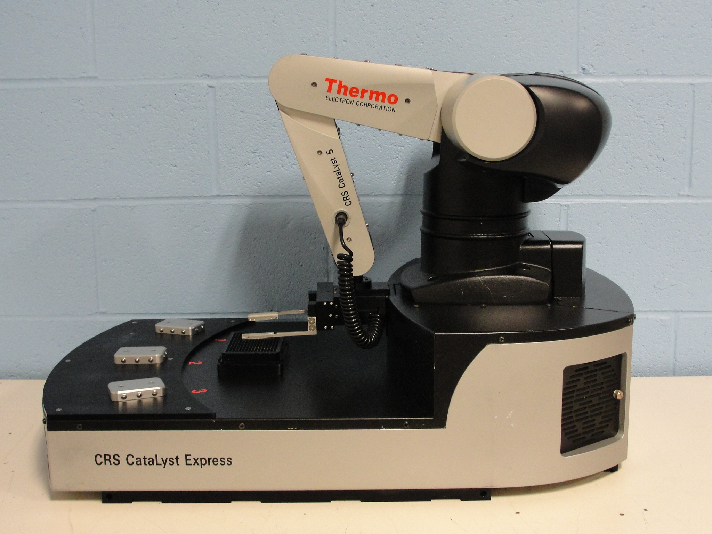
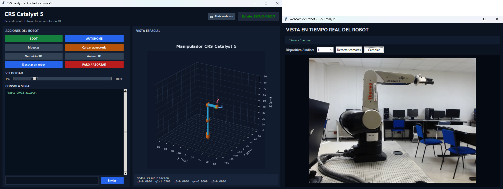
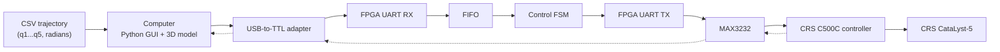

# CRS CataLyst-5 FPGA Trajectory Execution Platform

A computer-based platform for loading, visualizing, and executing joint-space trajectories on a five-degree-of-freedom CRS CataLyst-5 manipulator.





## Project overview

This research platform integrates a Python desktop application, an Intel Cyclone V GX FPGA communication interface, an electrical level-adaptation stage, and the original CRS C500C robot controller.

- **Host application:** loads externally generated CSV trajectories, visualizes robot configurations in 3D using forward kinematics, and coordinates sequential execution.
- **FPGA interface:** Verilog modules implement UART reception, temporary data storage, state-machine coordination, and UART transmission.
- **Electrical interface:** a MAX3232-based stage connects the FPGA transmit path to the C500C serial console.
- **Robot controller:** the original C500C retains the robot's native motion-control functions.

The controller response path returns to the computer through the MAX3232 and a USB-to-TTL adapter. It bypasses the FPGA. This platform does not replace the C500C, implement a new motion-control law, or autonomously plan trajectories.

## Architecture



The dashed return path represents controller responses to the computer and does not pass through the FPGA.

## Repository layout

```text
.
├── README.md
├── CITATION.cff
├── CONTRIBUTING.md
├── docs/
├── software/
│   ├── python/
│   └── requirements.txt
├── hardware/
│   ├── verilog/
│   │   ├── uart_rx/
│   │   ├── uart_tx/
│   │   └── fifo/
│   ├── quartus/
│   ├── source_documents/
│   └── evidence/
├── trajectory_examples/
├── media/
│   ├── images/
│   └── robot_execution/
└── results/
```

## Main technical characteristics

| Item | Description |
|---|---|
| Robot | CRS CataLyst-5, 5 DOF |
| Controller | Original CRS C500C |
| Host software | Python, Tkinter, Matplotlib, PySerial |
| FPGA | Intel Cyclone V GX, 5CGXFC5C6F27C7N |
| HDL | Verilog |
| Digital blocks | UART RX, FIFO, FSM, UART TX |
| Nominal serial rate | 57,600 baud |
| Electrical interface | MAX3232 |
| Trajectory variables | q1, q2, q3, q4, q5 |
| Trajectory units | Radians |

## Experimental results

The thesis reports ten returns to the MUESCAS (HOME) reference position, execution of a 20-configuration joint trajectory with controller acknowledgements, and FPGA resource use of 83 ALMs and one M10K block. These results support functional integration and execution feasibility; they are not an independent metrological characterization of positioning accuracy or mechanical repeatability. See [experimental results](docs/experimental_results.md).

## Documentation

- [Project overview](docs/project_overview.md)
- [System architecture](docs/system_architecture.md)
- [Software design](docs/software_design.md)
- [Hardware design](docs/hardware_design.md)
- [Trajectory CSV format](docs/trajectory_format.md)
- [Experimental results](docs/experimental_results.md)
- [Architecture diagram source](docs/diagrams/architecture_diagram.tex)

## Running the host application

See [software/README.md](software/README.md) for setup and execution instructions. The supplied script retains hardware-specific command sequences and a default serial port setting that must be checked before use.

## Safety notice

This repository documents a research platform connected to an industrial robot. Do not power or command the manipulator based only on this README. Verify wiring, electrical levels, controller state, emergency-stop arrangements, joint limits, workspace clearance, and laboratory supervision procedures before any physical test.

## Citation and licensing

See [CITATION.cff](CITATION.cff) for citation metadata. No open-source license is asserted here; publication and redistribution rights must be confirmed by the author before selecting a license.
