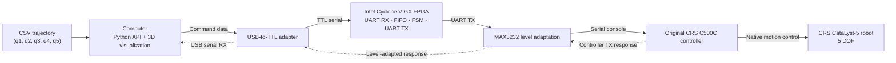

# System architecture diagram

The two serial paths are distinct. Solid arrows show command transmission toward the controller; dashed arrows show the controller response returning directly to the computer.

**Forward path:** computer/Python → USB-to-TTL → FPGA → MAX3232 → C500C.

**Return path:** C500C → MAX3232 → USB-to-TTL → computer/Python. The response path bypasses the FPGA.
